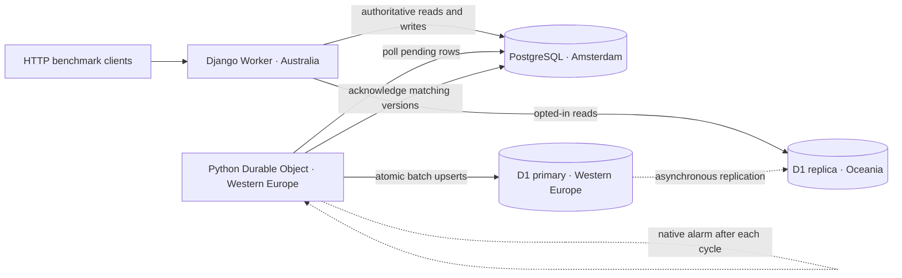

# Django at the edge, PostgreSQL at the core

A reference architecture exploring **D1 as an eventually consistent relational cache for Django on Cloudflare Workers**. PostgreSQL remains authoritative. A companion Durable Object polls pending rows and mirrors them into D1, whose read replicas can serve nearby requests.

The experiment requests Australian placement for Django and uses PostgreSQL in Amsterdam, then compares:

| Read policy | Session and user lookups | Blog queries | Writes |
|---|---|---|---|
| `postgres` | PostgreSQL | PostgreSQL | PostgreSQL |
| `auth_cache` | D1 | PostgreSQL | PostgreSQL |
| `all_cache` | D1 | D1 | PostgreSQL |

Requests select a policy with the `X-Read-Policy` header; the default is `postgres`. Methods other than GET and HEAD always use PostgreSQL. Content reads require an explicit `.eventually_consistent()` query as well as `all_cache`. Cache misses do not fall back to PostgreSQL, so cached authentication can temporarily miss a new session or retain a revoked one until synchronization and replica propagation complete.



## Status

**Measured on 2026-10-18: 1,999 authenticated API requests across 18 trials, with zero errors.** With ten concurrent clients, median client latency was:

| Read policy | Median API latency |
|---|---:|
| PostgreSQL only | 3,923 ms |
| D1 authentication cache | 3,591 ms |
| D1 authentication and content cache | 493 ms |

See the [full report](benchmark/results/2026-10-18-reference/report.md) for endpoint percentiles, SQL and connection timings, raw data, and six successful freshness scenarios. PostgreSQL connections close after every request. The roughly eightfold median improvement for the fully cached mode is specific to this experiment; tail latency varied under load.

A Sydney outbound probe corroborated the Worker's Australian placement hint. All 5,694 recorded D1 query observations came from an Oceania replica; the primary reported Amsterdam, and a post-run companion probe reported Lisbon. The platform omitted its per-request placement header, so exact execution location is not independently verified for every request. The validated deployment was seeded with 100 users and 10,000 posts; synchronization was stopped after validation.

See [validation status](docs/validation.md) for completed checks and measurement limitations. This is an experimental reference implementation, not a production-readiness claim.

## What is interesting here?

- **Normal Django models and migrations:** an abstract model supplies sync fields; `django-pgtrigger` installs model-declared PostgreSQL triggers. Bulk writes and SQL writes are tracked by the database.
- **Safe concurrent copying:** copy a version, then acknowledge only that version. An update during copying remains pending. Replays are idempotent, and older versions cannot overwrite newer ones in D1.
- **No replication feedback:** acknowledgement changes only metadata and does not increment the version or create another pending change.
- **Explicit read consistency:** business queries opt in through `.eventually_consistent()`. Authentication routing is request-local. Writes remain on PostgreSQL, including writes originating from a cached object/query.
- **A Python companion:** scheduling and sync live in the same deployment. Each alarm performs one cycle and schedules the next for `max(now, cycle_start + 1000ms)`. There is no external per-second scheduler and no Hyperdrive.
- **Reproducible HTTP experiments:** real sessions, cookies, CSRF, database lookups, and JSON APIs; no browser automation or response cache.

## Run it

Requirements: Python 3.14, uv, Node.js, Cloudflare Workers/D1 access, and a disposable PostgreSQL database reachable over TLS.

From the project root, put `AIVEN_POSTGRESQL_DSN` in `.env`, following [the example](benchmark/.env.example). Then:

```sh
cd benchmark
uv run --no-project python scripts/project.py configure
uv run --no-project python scripts/project.py install
```

Configuration generates ignored `benchmark/secrets.local.json`, `benchmark/.dev.vars`, and `benchmark/bindings.local.json` files; it does not print secret values. It creates `DJANGO_SECRET_KEY`, `CONTROL_TOKEN`, and `BENCH_PASSWORD`, preserving existing generated values on reruns. The benchmark client reads `secrets.local.json`; `BENCH_PASSWORD` is not uploaded as a Worker binding. Installation uses the native `uv.lock`, npm lockfile, and Worker `pylock.toml`. The build step materializes the local editable runtime SDK into the Worker bundle so it does not depend on a development-machine path.

The checked-in account and D1 IDs belong to this project's test deployment. When reproducing in another account, update the account ID, create your own database with `uv run pywrangler d1 create django-edge-cache --location weur`, update the binding ID, and [enable read replication](https://developers.cloudflare.com/d1/best-practices/read-replication/#enable-read-replication). Authenticate Wrangler for your account if necessary.

```sh
uv run --no-project python scripts/project.py deploy
uv run python scripts/bench.py setup --url https://YOUR-WORKER.workers.dev
```

Deployment uploads the Worker and then its secret bindings. Setup first checks direct PostgreSQL TLS, transaction rollback, and password hashing/verification in both the HTTP Worker and Durable Object, plus D1 batch rollback. It then stops sync, migrates PostgreSQL before D1, resets both stores, seeds **100 users (`reader000`–`reader099`) and 10,000 posts**, and starts sync. Setup deliberately resets this app's disposable tables and waits for the backlog and cached-read readiness checks.

```sh
uv run python scripts/bench.py run \
  --url https://YOUR-WORKER.workers.dev \
  --client-location "London, UK" \
  --output results/first-run

uv run python scripts/bench.py freshness \
  --url https://YOUR-WORKER.workers.dev \
  --output results/first-freshness

uv run --no-project python scripts/report.py results/first-run \
  --freshness results/first-freshness/freshness.json
```

The latency profile alternates authenticated post list/detail requests and defaults to concurrency **1 and 10**, **three repetitions**, **10 seconds warm-up** and **30 seconds measurement**, rotating policy order. Override these with `--concurrency`, `--repetitions`, `--warmup`, and `--duration`; concurrency is capped at 10 for the source's 20-connection limit. Do not overlap benchmark runs. Use a new output directory for each latency or freshness run; existing directories are rejected.

Runs record raw JSONL, environment/dependency metadata, runtime probes, errors, and synchronization snapshots; the report command adds CSV/JSON summaries, Markdown, and an SVG chart. Placement metadata retains unknown values. Freshness checks record primary and Australian-read observations for login, insert, update, soft delete, logout, and account deactivation. Freshness deactivates `reader099` and leaves tombstones; rerun `bench.py setup --url …` before repeating the complete experiment.

Do not claim the intended geography from configuration alone: the report checks Worker placement and D1 replica metadata. Unknown or unexpected locations are explicitly flagged.

The latency runner starts synchronization automatically and leaves it running. Inspect its status and stop the companion when the experiment is idle:

```sh
uv run python scripts/bench.py status --url https://YOUR-WORKER.workers.dev
uv run python scripts/bench.py stop --url https://YOUR-WORKER.workers.dev
```

To remove the dedicated Worker and cache, run `uv run --no-project python scripts/project.py cleanup --url https://YOUR-WORKER.workers.dev` from `benchmark/`. This stops the companion, deletes the Worker named `django-edge-reference` and D1 database named `django-edge-cache`, and leaves PostgreSQL intact. If you rename those resources, also update the cleanup targets in `scripts/project.py`.

## Tests and design

```sh
cd benchmark
PYTHONPATH=src uv run --no-project python -m unittest discover -s tests -v
EDGE_SQLITE_TEST=1 PYTHONPATH=src uv run python -m unittest discover -s tests -v
EDGE_SQLITE_TEST=1 uv run python src/manage.py makemigrations --check --dry-run
EDGE_POSTGRES_TESTS=1 PYTHONPATH=src uv run python -m unittest discover -s tests -p test_postgres.py -v
```

The first command runs the standard-library checks, with HTTP client checks enabled when `httpx` is installed; Django/SQLite and PostgreSQL tests are opt-in. The second checks Django/API behavior with native SQLite; it does **not** verify PostgreSQL triggers or Cloudflare bindings. The third checks model/migration consistency. The final command installs migrations into the disposable PostgreSQL source and tests the actual triggers, rolling back test rows afterward. Deployed checks remain necessary for Python TCP/TLS, D1, and Durable Objects.

See [design and limitations](docs/design.md) for synchronization details, read semantics, API controls, and failure handling.

## Upstream attribution

`workers-py/` contains the MIT-licensed [Cloudflare workers-py repository](https://github.com/cloudflare/workers-py), imported from revision `c62b46790a773de6edf59216c054bdb8244e1485`. Its [license](workers-py/LICENSE) and package licenses are preserved. The application is adapted from its `django-cf` D1 template.

The prototype uses these packages through local dependency references. **No upstream package changes have been required so far.** Project-specific routing, D1 sessions, synchronization, and measurements live in `benchmark/`.
