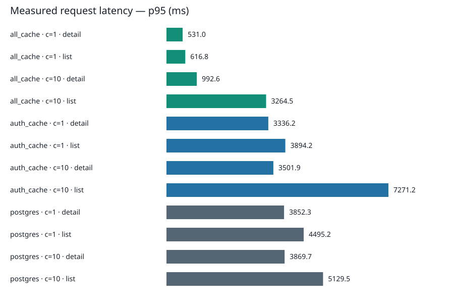

# Benchmark results

Run: 2026-10-18T13:21:13.606755+00:00

Client location: Local MacBook; London ingress; physical location unverified

Revision: `3a11d0c4eaf61767ae3abead2fe4e5efa806e403`; dirty tree: True

Authenticated HTTP requests, alternating list/detail, with warm-up excluded. Connections close after each request; client latency includes connection setup.

| Policy | Clients | Endpoint | Success/total | p50 ms | p95 ms | p99 ms | Success/s |
|---|---:|---|---:|---:|---:|---:|---:|
| all_cache | 1 | detail | 87 / 87 | 456.74 | 531.02 | 660.85 | 0.96 |
| all_cache | 1 | list | 89 / 89 | 513.63 | 616.82 | 1028.57 | 0.98 |
| all_cache | 10 | detail | 635 / 635 | 439.09 | 992.64 | 4197.06 | 6.31 |
| all_cache | 10 | list | 654 / 654 | 528.29 | 3264.46 | 6814.35 | 6.49 |
| auth_cache | 1 | detail | 12 / 12 | 3168.82 | 3336.24 | 3393.49 | 0.13 |
| auth_cache | 1 | list | 15 / 15 | 3596.75 | 3894.23 | 3898.17 | 0.16 |
| auth_cache | 10 | detail | 116 / 116 | 3178.26 | 3501.90 | 6504.17 | 1.17 |
| auth_cache | 10 | list | 135 / 135 | 3814.44 | 7271.22 | 9788.84 | 1.36 |
| postgres | 1 | detail | 12 / 12 | 3785.30 | 3852.31 | 3865.62 | 0.13 |
| postgres | 1 | list | 12 / 12 | 4200.26 | 4495.23 | 4587.33 | 0.13 |
| postgres | 10 | detail | 114 / 114 | 3715.20 | 3869.72 | 3929.49 | 1.13 |
| postgres | 10 | list | 118 / 118 | 4296.25 | 5129.54 | 10605.79 | 1.17 |

Percentiles use successful requests only. Failures remain in raw data and counts. Treat p99 as exploratory when a group has fewer than 1,000 successful samples.

SQL call means include adapter and network time. PostgreSQL connection setup is reported separately. Authentication and content are request segment medians.

| Policy | Clients | Endpoint | PG connect p50 ms | Auth p50 ms | Content p50 ms | PG SQL mean ms | D1 SQL mean ms |
|---|---:|---|---:|---:|---:|---:|---:|
| all_cache | 1 | detail | — | 46.00 | 24.00 | — | 25.39 |
| all_cache | 1 | list | — | 46.00 | 78.00 | — | 42.17 |
| all_cache | 10 | detail | — | 53.00 | 26.00 | — | 75.28 |
| all_cache | 10 | list | — | 53.00 | 96.50 | — | 95.65 |
| auth_cache | 1 | detail | 2123.50 | 48.00 | 2722.00 | 301.50 | 27.25 |
| auth_cache | 1 | list | 2140.00 | 47.00 | 3211.00 | 386.63 | 24.33 |
| auth_cache | 10 | detail | 2132.50 | 45.00 | 2729.50 | 300.09 | 70.43 |
| auth_cache | 10 | list | 2178.00 | 47.00 | 3349.00 | 440.12 | 176.31 |
| postgres | 1 | detail | 2173.00 | 3091.50 | 303.00 | 302.36 | — |
| postgres | 1 | list | 2085.00 | 2966.00 | 881.00 | 364.10 | — |
| postgres | 10 | detail | 2170.00 | 3080.00 | 301.00 | 299.96 | — |
| postgres | 10 | list | 2164.00 | 3079.50 | 904.50 | 368.57 | — |

Worker placement counts: `{'unknown': 1999}`

D1 region counts: `{'OC': 5694}`; primary flags: `{'False': 5694}`

Australian execution verified for every recorded request: **False**. Oceania replica service observed: **True**.

Out-of-band egress probes (not per-request placement): HTTP Worker `SYD`; sync companion `unknown`. These identify the colo serving an outbound Cloudflare trace request. They corroborate configured placement but do not replace missing per-request evidence.

Post-run companion egress probe: `LIS` at `2026-10-18T13:38:01.880085+00:00`.

When per-request placement is unknown, location evidence is limited to the configured placement hint and out-of-band probes. Treat the geographic comparison as exploratory. If no Oceania replica service is observed, the intended replica comparison is unverified.

Errors: `{}`

Unexpected database routing among successful requests: `{}`. Postgres mode must query only PostgreSQL; auth-cache mode must query both stores; all-cache mode must query only D1.

Database errors by SQLSTATE/type: `{}`. SQLSTATE 53300 indicates too many connections. Clients are capped at 10 for the declared 20-connection limit; sync uses one additional connection.

Synchronization snapshots appear in `trials.jsonl`; connection and query timings, authentication/content segments, and per-request placement appear in `requests.jsonl`. Propagation scenarios are recorded separately by the freshness command.

## Freshness observations

Elapsed time at the client after each mutation response, including observation round trips. These are visibility observations, not exact replication lag or a one-second freshness guarantee.

| Event | Primary visible ms | Cached read visible ms | Read attempts |
|---|---:|---:|---:|
| login | 692.95 | 486.80 | 1 |
| insert | 693.25 | 1127.23 | 2 |
| update | 705.35 | 511.19 | 1 |
| soft_delete | 1499.28 | 1087.82 | 2 |
| logout | 662.08 | 401.86 | 1 |
| deactivate | 667.48 | 988.22 | 2 |
