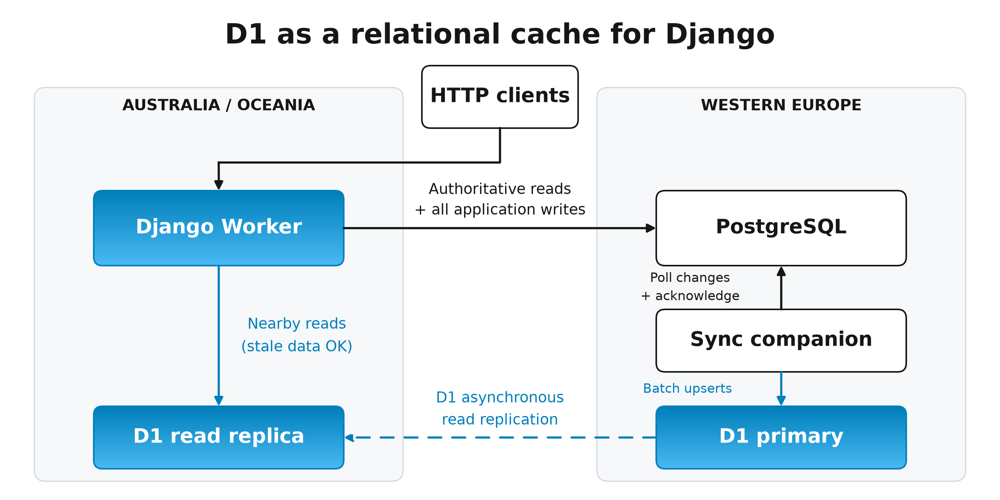
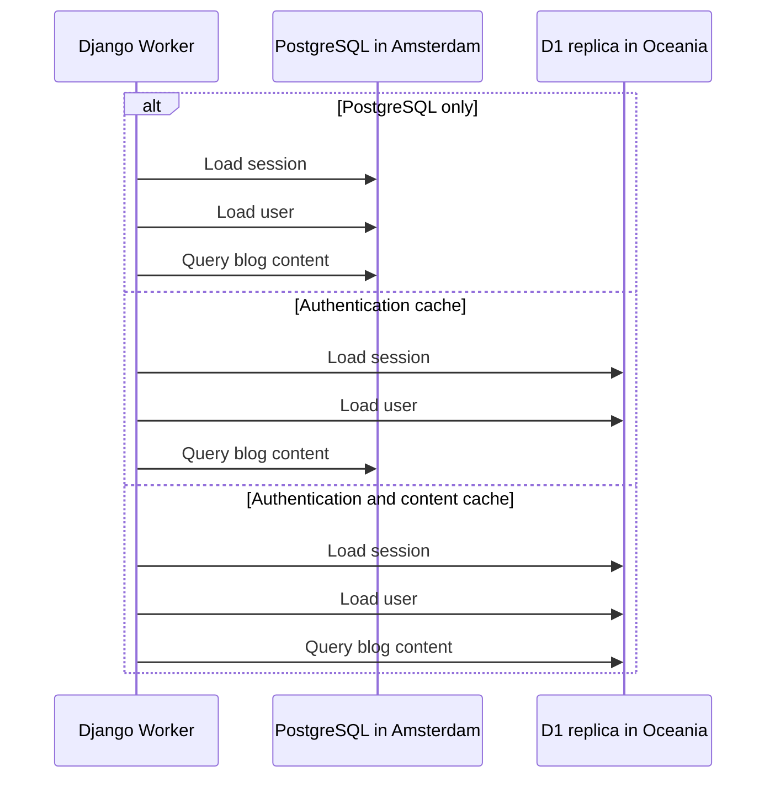
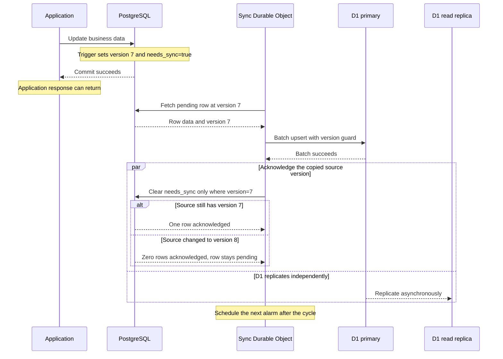
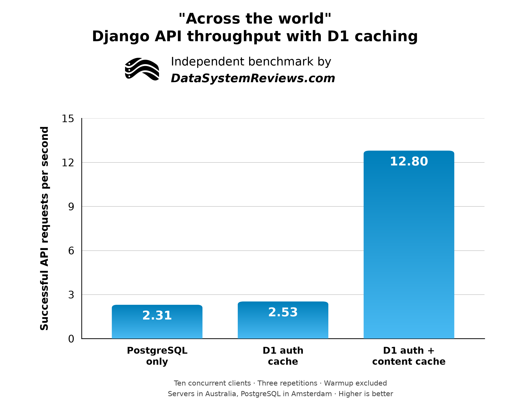
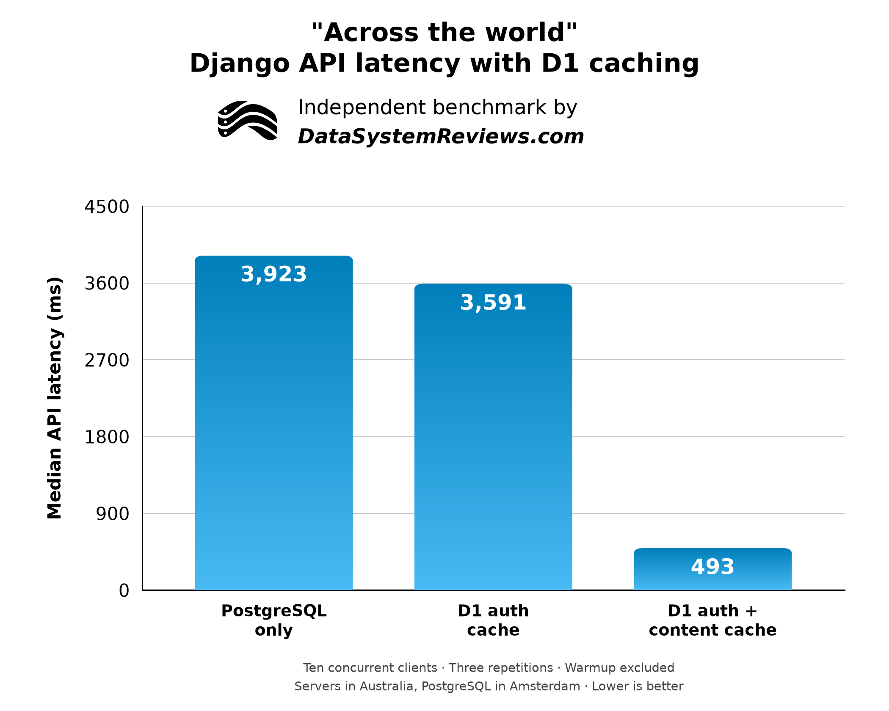

# Cloudflare D1 as a PostgreSQL Cache for Django

In this experiment, I used Cloudflare D1 as an eventually consistent relational cache in front of PostgreSQL. With ten concurrent clients, caching both authentication and content reduced median API latency from **3.92 seconds to 0.49 seconds**. Throughput increased from **2.31 to 12.80 requests per second**.

That is about an **8X improvement in median response time** and a **5.5X improvement in throughput** for this workload.

The application was a Django project on a Cloudflare Worker configured to run near Sydney. PostgreSQL stayed in Amsterdam. Each request that used PostgreSQL opened a new connection, which turned out to be a large part of the result. This is a comparison of application architectures, with geography and connection setup included in the measurements.

Caching only authentication produced a much smaller benefit. There were also some slow outliers worth discussing before getting too excited about the median.

## Why use a relational cache?

An edge deployment can put an ocean between an application and its database. Django still needs to load a session, look up a user, and query whatever content the user requested. Each of those steps can involve a database round trip.

I have [run into the cost of network latency in database benchmarks before](https://datasystemreviews.com/postgresql-vs-mysql-performance-comparison.html#networking). For this test, I deliberately made the distance much larger.

I wanted to keep PostgreSQL as the authoritative database while giving Django a nearby SQL database for reads that could tolerate stale data. D1 was interesting because I could mirror tables into it and keep using ORM queries to filter, count, order, and fetch rows.

The application in this test is intentionally small: database-backed authentication and a blog API. It is enough to exercise middleware lookups followed by business queries, without adding unrelated application features.

## Test architecture

I built a small Django application with database-backed authentication and a blog API. It has three mirrored models: users, sessions, and posts. PostgreSQL in Amsterdam is the source of truth. D1 holds an eventually consistent copy that Django can query using its ORM.



The Django application runs on a Python Cloudflare Worker configured with an Australian placement hint. D1 read replication is enabled, so the application can read from a nearby replica rather than making every database query across the world. During the benchmark, all recorded D1 queries were served by an Oceania replica.

There are two database paths:

- **Authoritative reads and all application writes go to PostgreSQL.** Queries that need current state still use the central database, and writes commit there before synchronization happens.
- **Reads that can tolerate stale data go to D1.** A Django database router can send session and user lookups to the cache, while business queries explicitly opt in with `.eventually_consistent()`. Ordinary business queries continue to use PostgreSQL.

To keep the cache updated, I added a Python Durable Object as a synchronization companion, with a Western Europe placement hint. PostgreSQL triggers mark changed rows as pending and increment their versions. The companion polls those rows on a target cadence of roughly one second, copies them into D1's primary using version-guarded batch upserts, and acknowledges only the source versions it successfully copied. If a row changes while it is being copied, it stays pending for another pass. Deletions are copied as tombstones.

D1 then handles asynchronous replication from its primary in Amsterdam to its read replicas. The dashed arrow shows this Cloudflare-managed step; the solid arrows show calls made by Django and the companion. This creates two stages of delay: PostgreSQL to the D1 primary, then the primary to a read replica. Even D1's primary can lag behind PostgreSQL, and the one-second polling target is not a freshness guarantee.

Replica reads use the [D1 Sessions API](https://developers.cloudflare.com/d1/best-practices/read-replication/), with a fresh `first-unconstrained` session for each cached request. This gives the request's D1 queries sequential consistency, but does not guarantee that they include the latest PostgreSQL writes. Cached authentication also means that session revocations and account deactivations take time to propagate; paths that require immediate checks must read PostgreSQL.

For the experiment, I seeded 100 users and 10,000 posts and used authenticated HTTP requests to alternate between list and detail endpoints. PostgreSQL connections use direct TLS, without Hyperdrive, and close after each request. This makes connection setup part of the measured cost.

One geographic detail matters: the load generator was a local MacBook with London ingress; its physical location was not independently verified. These measurements therefore do not establish Australian end-user latency. A Sydney egress probe corroborated the Worker's Australian placement hint, but execution location was not available for every request. D1's Oceania replica region was recorded directly.

### Three read policies

I deployed one application and selected its read policy with an HTTP header. That let me compare the same endpoints and data under three configurations:

| Policy | Session and user lookups | Blog queries |
|---|---|---|
| PostgreSQL only | PostgreSQL | PostgreSQL |
| Authentication cache | D1 | PostgreSQL |
| Authentication and content cache | D1 | D1 |



This diagram shows where the reads go. A blog detail request needs one content query. A list request needs two: a count and a page of 20 posts. Including authentication, that means three or four database queries per measured request.

Django's database router handles the authentication models. Business queries opt into the cache through a queryset method:

```python
posts = Post.objects.eventually_consistent().order_by("-pub_date")[:20]
```

That method selects D1 only when the request's policy allows cached content reads. Unmarked business queries, locking reads, and application writes use PostgreSQL. The benchmark does not fall back to PostgreSQL on a D1 miss, which would obscure the behavior being measured.

## Keeping the cache synchronized

The synchronization protocol uses three fields on each mirrored row:

| Field | Purpose |
|---|---|
| `sync_version` | A version that increases when the row's business data changes |
| `needs_sync` | Marks a row whose current version needs copying to D1 |
| `is_deleted` | Represents deletion while retaining a row that can be synchronized |

These fields are declared on an abstract Django model. PostgreSQL triggers maintain the version and pending flag. I used [django-pgtrigger](https://django-pgtrigger.readthedocs.io/en/stable/) to declare those triggers alongside the models and install them through Django migrations.

The trigger matters because it tracks changes made through normal saves, bulk ORM operations, and raw SQL. The domain change and its replication metadata commit in the same PostgreSQL transaction.

Here is how copying a row works, using version 7 as an example:



Acknowledgment means D1's primary accepted the copied row. Read replicas can still lag behind that primary.

The conditional acknowledgment prevents a concurrent write from getting lost. If the source row changes while its previous version is being copied, the acknowledgment matches zero rows. The new version remains pending for a later cycle.

D1's upsert also checks the incoming version, so an older copy cannot overwrite a newer row. Replaying a batch after an interrupted acknowledgment is safe.

There is one other important detail: clearing `needs_sync` must not count as a business update. Otherwise, acknowledging a copy would increment the version and create another change to copy. The trigger excludes replication metadata from its business-change comparison, avoiding that feedback loop.

Deletes become tombstones through `is_deleted`, and application managers hide them from ordinary reads. The prototype rejects physical row deletes on PostgreSQL so the synchronizer has a deletion record to copy.

### Scheduling the synchronizer

A Durable Object does not run forever like a conventional Python process. I used a native [Durable Object alarm](https://developers.cloudflare.com/durable-objects/api/alarms/) to wake it for each cycle.

The first start request schedules the initial alarm. At the end of a successful cycle, it schedules the next alarm for the later of:

- The current time.
- One second after the cycle started.

A quick cycle waits out the remainder of the second. A cycle taking more than a second schedules its successor immediately. Failed cycles back off, and copying remains idempotent. There is no external service calling the object every second.

The synchronizer processes bounded batches of 100 rows, with up to ten batches per table per cycle. One second is a target cadence, rather than a maximum staleness guarantee.

## Benchmark setup

The test ran on October 18, 2026, with the following configuration:

| Component | Configuration |
|---|---|
| Application | Django 5.2.18 on a Python Cloudflare Worker |
| Worker placement | `aws:ap-southeast-2` hint, near Sydney |
| Source database | Aiven PostgreSQL 18.6 in Amsterdam |
| Source connection limit | 20 |
| D1 primary | Western Europe placement; primary probe reported Amsterdam |
| D1 reads | Read replication enabled; request-local D1 sessions |
| Dataset | 100 seeded users and 10,000 blog posts |
| Workload | Authenticated JSON API requests, alternating list and detail endpoints |
| Concurrent clients | 1 and 10 |
| Repetitions | Three per policy and concurrency level, rotating policy order |
| Warmup | 10 seconds before each measurement window |
| Measurement window | 30 seconds, allowing in-flight requests to finish |

The synchronizer stayed enabled under all three policies. I capped clients at ten to leave room beneath Aiven's 20-connection limit.

Clients logged in before timed requests began, and the runner waited for sessions and content to reach the cache. The authentication work measured inside the read trials is session and user lookup, rather than password verification.

The load generator ran on a MacBook, with requests entering Cloudflare through London. Reported API latency includes the client-to-Worker network path. PostgreSQL connections were closed after every request; their setup time is included in the results and recorded separately.

An outbound probe from the HTTP Worker reported Sydney, and all **5,694 recorded D1 query observations** reported an Oceania read replica. A post-run companion probe reported Lisbon. Cloudflare omitted the documented per-request placement header, so those configuration hints and probes corroborate location without independently locating every measured request.

## Results

All **1,999 measured requests across 18 trials succeeded**. The recorded query counts also matched the intended routing: PostgreSQL only, both stores, or D1 only.

Here are the results at ten concurrent clients, pooling the three repetitions and both endpoints:

| Architecture | Median API latency | p95 API latency | Successful requests per second |
|---|---:|---:|---:|
| PostgreSQL only | 3.92 s | 4.55 s | 2.31 |
| D1 authentication cache | 3.59 s | 6.75 s | 2.53 |
| D1 authentication and content cache | 0.49 s | 2.80 s | 12.80 |



*Ten concurrent clients, three repetitions per architecture, warmup excluded. Servers in Australia, PostgreSQL in Amsterdam. Higher is better. [Download the chart data](django-d1-chart-data.csv).*

Throughput is successful requests divided by total elapsed measurement time across matching trials, including the time needed to finish in-flight requests. This is throughput at the tested concurrency, rather than a search for maximum system capacity.



*Ten concurrent clients, three repetitions per architecture, warmup excluded. Servers in Australia, PostgreSQL in Amsterdam. Lower is better. These are full API request times, including the client-to-Worker network path.*

The single-client results had the same ordering. Median latency was **3.98 seconds** with PostgreSQL only, **3.41 seconds** with authentication cached, and **0.51 seconds** with both authentication and content cached.

### Why authentication caching helped less

Authentication was expensive in the baseline. At ten concurrent clients, its median measured segment took about **3.08 seconds**. With authentication cached, that segment fell to approximately **46 milliseconds**.

That sounds like it should transform the whole request, but PostgreSQL connection setup was responsible for much of the original authentication time. Opening the connection took approximately **2.17 seconds**, and the content query still needed that connection.

Caching authentication moved connection setup into the content segment. It saved the remote session and user queries, while preserving the large connection cost later in the request.

The single-client result makes the round-trip savings easier to see: authentication caching reduced overall median latency by roughly **570 milliseconds**. PostgreSQL SQL calls generally took around 300 milliseconds each, so replacing two remote lookups with nearby reads produced a plausible improvement.

### Why caching content made the larger difference

Once content also came from D1, the measured read requests no longer opened a PostgreSQL connection or executed PostgreSQL queries.

At ten concurrent clients, median server time fell from about **3.55 seconds to 126 milliseconds**. Median client latency fell from **3.92 seconds to 493 milliseconds**. The remaining client latency includes the long network path to the Worker and other overhead outside the measured server segment.

Avoiding remote connection setup is a major part of that improvement. Reusing PostgreSQL connections would narrow the comparison, while the distance-related query round trips would remain. The separate connection and SQL timings in the raw results make that distinction visible.

### The slow requests still matter

The fully cached mode had the best median and throughput, but its p95 at ten concurrent clients was still **2.80 seconds**. Some requests took more than eight seconds. Authentication-only caching had a worse p95 than the PostgreSQL baseline despite its lower median.

Several slow cached requests spent seconds awaiting authentication queries while D1 reported sub-millisecond SQL execution for those lookups. The unexplained delay is outside that reported SQL execution time. Service queueing, network transport, runtime scheduling, adapter overhead, and measurement effects are possible areas to investigate; this run does not identify the cause.

I would investigate those outliers and run longer tests before making claims about consistent latency under load. The endpoint-level p95 and p99 values are available with the raw results. The p99 estimates are particularly tentative because each endpoint group has fewer than 1,000 successful samples.

## How stale were the cached reads?

After the latency run, I tested six kinds of changes and waited for each to become visible through the cached API:

| Change | Cached visibility observed after mutation response |
|---|---:|
| Login | 487 ms |
| Insert a post | 1,127 ms |
| Update a post | 511 ms |
| Soft-delete a post | 1,088 ms |
| Logout | 402 ms |
| Deactivate an account | 988 ms |

All six scenarios passed. The logout test deliberately reused the revoked session cookie, so it exercised replicated revocation rather than simply observing the client's cookie removal.

These times include polling and network transport after the mutation response reached the client. They are visibility observations, rather than exact PostgreSQL-commit-to-replica delays. Six successful cases also do not establish a lag distribution or the synchronizer's capacity under sustained writes.

Cached authentication makes revocation eventual too. A cached session or account can remain usable until its change reaches the read path. Requests requiring immediate authoritative checks need the PostgreSQL policy.

## What I would use this for

The result makes me interested in this pattern for read-heavy applications where selected requests can tolerate stale data. Keeping Django's query model while moving those reads close to the application produced a substantial improvement in this experiment.

The prototype covers three mirrored models and a small set of single-table queries. Rows are copied independently, so a multi-table PostgreSQL transaction is not reproduced as one atomic D1 change. Broader SQL compatibility, schema evolution, cache rebuilding, and sustained write workloads need more work. It also adds a synchronizer and a second database system to operate.

My strongest conclusion is that **the largest gain came from removing the final remote database dependency from the read request**. Caching authentication saved round trips. Caching authentication and content also removed connection setup, which changed the result much more dramatically.

The [Django Edge reference repository](https://github.com/calmitchell617/django-edge) contains the implementation and reproduction instructions. The [benchmark report](https://github.com/calmitchell617/django-edge/blob/main/benchmark/results/2026-10-18-reference/report.md) includes endpoint breakdowns, query timings, synchronization snapshots, and links to the underlying measurements.
